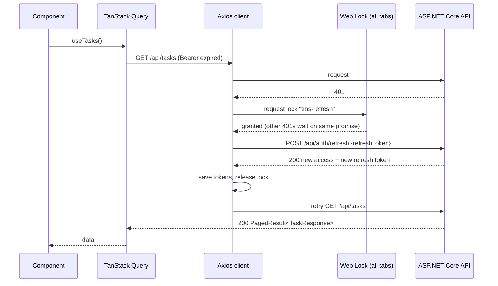

# Phase 1 — Requirements and UI/UX Design

> Status: **✅ Verified — approved 2026-11-26** (all decisions in §16 approved). No frontend code is written in this phase.
> Backend changes for G1/G2 were implemented and tested in the backend repo — see its `docs/16-Frontend-Support-Endpoints.md`.
> Source of truth: the backend at `../01-MonolithicArchitecture-TaskManagementSystem/src/TaskManagementSystem`
> (controllers, DTOs, validators, authorization handlers). Every endpoint, field and rule below was read
> from that code — nothing is invented. Items the backend does **not** support are listed in §0.3.

---

## 0. Backend contract — what we inspected

### 0.1 Facts that shape the frontend

| Topic | Actual backend behaviour | Frontend consequence |
|---|---|---|
| Base URL (dev) | `http://localhost:5075` (`https://localhost:7188`), Swagger at `/swagger` in Development | `VITE_API_BASE_URL` env variable |
| CORS | Only `http://localhost:3000` allowed; no credentials; exposes `X-Correlation-ID` | Vite dev server must run on **port 3000** (not 5173) |
| Email links | `{ClientAppBaseUrl}/confirm-email?userId=..&token=..` and `/reset-password?email=..&token=..` | These two **route paths are fixed** by the backend |
| JSON | camelCase; **enums as strings** (`"InProgress"`, `"High"`) | TS string-literal unions, not numeric enums |
| Dates | `DateTime` = UTC ISO strings; `DateOnly` = `"yyyy-MM-dd"` (project start/end) | Two date helpers: UTC datetimes vs plain dates |
| Errors | RFC 9457 ProblemDetails: `status, title, detail, instance, traceId, correlationId`, plus `errors: { field: string[] }` on 400 | One error parser; field errors mapped onto React Hook Form |
| Paging | `PagedResult<T>`: `items, page, pageSize, totalCount, totalPages, hasPreviousPage, hasNextPage`; pageSize 1–100, default 20 | One generic `Pagination` component |
| Access token | JWT, 15 min, sent as `Authorization: Bearer` | Kept **in memory only** |
| Refresh token | Opaque, 7 days, returned **in the JSON body** (not a cookie); **rotated** on every refresh; reusing an old one **revokes all sessions** | See §14.3 — needs single-flight refresh **across tabs** |
| JWT claims | `sub, email, given_name, family_name, jti, role, email_verified` | UI reads the user from `AuthResponse.user` / `GET /api/auth/me`, not by decoding the JWT |
| Login rules | Unverified users **can** log in; inactive users get 401; 5 failed attempts → 15 min lockout (also 401) | Generic "Invalid email or password" message |
| Email verification | Most **write** endpoints require `email_verified=true` (403 otherwise) | "Verify your email" banner + disabled write actions |

### 0.2 Endpoint inventory (41 endpoints)

| Area | Method & path | Auth | Notes |
|---|---|---|---|
| Auth | `POST /api/auth/register` | anon | 201 → `UserProfileResponse` (no tokens), 409 duplicate email |
| | `POST /api/auth/login` | anon | 200 → `AuthResponse`, 401 |
| | `POST /api/auth/refresh` | anon | body `{refreshToken}` → new `AuthResponse`, 401 |
| | `POST /api/auth/logout` | anon | body `{refreshToken}` → 204 |
| | `POST /api/auth/logout-all` | auth | 204 |
| | `GET /api/auth/me` | auth | `UserProfileResponse` |
| Account | `POST /api/account/confirm-email` | anon | `{userId, token}` → 204 / 400 |
| | `POST /api/account/resend-confirmation` | anon | `{email}` → always 202 |
| | `POST /api/account/forgot-password` | anon | `{email}` → always 202 |
| | `POST /api/account/reset-password` | anon | `{email, token, newPassword}` → 204 (revokes all sessions) |
| | `POST /api/account/change-password` | auth | `{currentPassword, newPassword}` → 204 (revokes all sessions) |
| Dashboard | `GET /api/dashboard` | auth | `DashboardResponse` (Admin: all projects, others: my projects) |
| Categories | `GET /api/categories`, `GET /api/categories/{id}` | auth | list is **not paged** |
| | `POST`, `PUT /{id}`, `DELETE /{id}` | Admin + verified | 409 duplicate name |
| Projects | `GET /api/projects` | auth | `search, ownedByMe, sortBy(CreatedAt/Name/StartDate/EndDate), sortDirection, page, pageSize` |
| | ↳ each item also has `openTaskCount`, `doneTaskCount`, `completionPercent` | | **added for G2** |
| | `GET /api/projects/{id}` | member/Admin | `ProjectDetailsResponse` incl. members |
| | `POST /api/projects` | (Admin or Manager) + verified | caller becomes Owner |
| | `PUT /{id}`, `DELETE /{id}` | owner/Admin | |
| | `POST /{id}/members` `{userId}` | owner/Admin | 409 already member, 422 inactive/unknown user |
| | `DELETE /{id}/members/{userId}` | owner/Admin | 422 cannot remove owner |
| Tasks | `GET /api/tasks` | auth | `projectId, status, priority, categoryId, assignedToId, assignedToMe, dueFrom, dueTo, overdue, search, sortBy, sortDirection, page, pageSize` |
| | `GET /api/tasks/{id}` | member/Admin | |
| | `POST /api/tasks` | member + verified | starts `Todo`, unassigned; 422 bad category / due after project end |
| | `PUT /{id}` | owner/creator/Admin + verified | status & assignee are NOT in this body |
| | `PATCH /{id}/assignee` `{assignedToId|null}` | owner/Admin + verified | 422 not an active member |
| | `PATCH /{id}/status` `{status}` | owner/creator/assignee/Admin + verified | 409 invalid transition |
| | `DELETE /{id}` | owner/creator/Admin + verified | |
| Comments | `GET /api/tasks/{taskId}/comments` | member/Admin | paged, oldest first, pageSize 50 |
| | `POST /api/tasks/{taskId}/comments` | member + verified | max 2000 chars |
| | `PUT /api/comments/{id}` | **author only** (not even Admin) | |
| | `DELETE /api/comments/{id}` | author/project owner/Admin | |
| Users | `GET /api/users` | Admin + verified | `search, role, isActive, sortBy(Email/Name/CreatedAt/LastLogin)` |
| | `GET /api/users/lookup?search=&limit=` | (Admin or Manager) + verified | **added for G1** — `[{id, fullName, email, jobTitle}]`, active users only, search ≥ 2 chars, limit 1–20 |
| | `GET /api/users/{id}` | self or Admin | |
| | `PUT /api/users/me` | verified | `{firstName, lastName, jobTitle}` |
| | `PUT /api/users/{id}/roles` | Admin + verified | 422 removing own Admin role |
| | `PATCH /api/users/{id}/status` `{isActive}` | Admin + verified | 422 deactivating self; 409 concurrency |

### 0.3 Gaps: requested features vs. the backend — **decided**

| # | Requested / shown in reference images | Backend reality | Option A — frontend only (no backend change) | Option B — small backend addition | Recommendation |
|---|---|---|---|---|---|
| G1 | **Add project member** by picking a user | `POST /members` needs a `userId` (Guid), but the only user search (`GET /api/users`) is **Admin-only**. A Manager who owns a project can't find anyone. | Admin gets a searchable picker; non-Admin owners must paste a user id (bad UX) | `GET /api/users/lookup?search=` for Admin/Manager → `{id, fullName, email}` of active users, max 10 results | **B ✅ implemented** |
| G2 | Project cards with **progress %** (reference image) | `ProjectSummaryResponse` has `taskCount` only. Progress exists only in the dashboard (top 10 projects). | Cards show task count + members + dates; progress only on the project details page (computed with `GET /api/tasks?projectId=&status=Done&pageSize=1` → `totalCount`) | Add `doneTaskCount`, `openTaskCount`, `completionPercent` to `ProjectSummaryResponse` (the repository already uses COUNT sub-queries) | **B ✅ implemented** |
| G3 | **Recent activities** | No activity/audit log | "Recently updated tasks" = `GET /api/tasks?sortBy=UpdatedAt&sortDirection=Desc&pageSize=6` (honestly labelled) | An activity log table — real new feature | **A** |
| G4 | **Notification preferences** | No notifications exist | Device-level UI preferences in `localStorage` (e.g. toast duration, compact mode), clearly labelled "on this device" | — | **A** (or drop the section) |
| G5 | **Team management / member profiles** | No team entity; other users' profiles are Admin-only (`GET /api/users/{id}`) | Team = members of my projects (from `ProjectDetailsResponse.members`); member profile = name, email, project role, joined date + their tasks via `GET /api/tasks?assignedToId=`. Admin also gets the full user directory. | — | **A** |
| G6 | Kanban card **comment/attachment counts**, avatars, photo upload, phone, social links, 2FA, time tracking, monthly trend charts, "completed by assignee" | Not in any DTO | Not shown. Avatars = coloured initials. Charts use only real dashboard data. | — | **A** (out of scope) |
| G7 | Kanban columns "To Do / In Progress / In Review / Completed" | Backend has a 5th status: **Cancelled** | 4 main columns + a collapsible "Cancelled" column | — | **A** |

> G1 and G2 (Option B) were implemented in the backend on 2026-11-26 with 21 new tests (all 188 backend tests pass).
> G3–G7 use the frontend-only approach. The backend stays one monolith.

---

## 1. Application page inventory

Legend — Access: **P** public (logged-out only), **A** any authenticated user, **V** needs verified email for actions, **M** Admin or Manager, **AD** Admin only.

| # | Page | Route | Access | Main endpoints |
|---|---|---|---|---|
| 1 | Login | `/login` | P | `POST /auth/login` |
| 2 | Register | `/register` | P | `POST /auth/register` |
| 3 | Registration success ("check your email") | `/register/success` | P | `POST /account/resend-confirmation` |
| 4 | Forgot password | `/forgot-password` | P | `POST /account/forgot-password` |
| 5 | Reset password (email link) | `/reset-password?email&token` | P | `POST /account/reset-password` |
| 6 | Confirm email (email link) | `/confirm-email?userId&token` | public **or** logged in | `POST /account/confirm-email` |
| 7 | Dashboard | `/` → `/dashboard` | A | `GET /dashboard`, `GET /tasks` (upcoming, recent) |
| 8 | Projects list | `/projects` | A (create: M+V) | `GET /projects` |
| 9 | Project details (tabs: Overview, Tasks, Board, Members) | `/projects/:projectId` (+ `/tasks`, `/board`, `/members`) | member/AD | `GET /projects/{id}`, `GET /tasks?projectId=` |
| 10 | Tasks list ("All tasks" / "My tasks") | `/tasks` | A | `GET /tasks`, `GET /categories` |
| 11 | Task details (+ comments) | `/tasks/:taskId` | member/AD | `GET /tasks/{id}`, `GET /projects/{id}`, comments |
| 12 | Kanban board (project picker) | `/board` → `/projects/:projectId/board` | A | `GET /tasks?projectId=&status=` |
| 13 | Categories | `/categories` | A (manage: AD+V) | categories CRUD |
| 14 | Team | `/team` | A | `GET /projects`, `GET /projects/{id}` |
| 15 | Member profile | `/team/:userId` | A | project members + `GET /tasks?assignedToId=` |
| 16 | My profile | `/profile` | A (edit: V) | `GET /auth/me`, `PUT /users/me` |
| 17 | Settings (tabs: Account, Security, Appearance, Preferences) | `/settings/:tab` | A | `change-password`, `logout-all` |
| 18 | Admin — Users | `/admin/users` | AD | `GET /users`, roles, status |
| 19 | Admin — User details | `/admin/users/:userId` | AD | `GET /users/{id}` |
| 20 | Admin — Overview (links to all projects / tasks / categories — Admin already sees everything there) | `/admin` | AD | `GET /dashboard` |
| 21 | 403 Forbidden | `/forbidden` | A | — |
| 22 | 404 Not found | `*` | all | — |
| 23 | Session expired (modal on any page, then `/login?returnUrl=`) | — | — | — |

Modals (not pages): Create/Edit project, Create/Edit task, Create/Edit category, Add member, Assign task, Change roles, Confirm delete / deactivate.

---

## 2. User journeys

**J1 — New user onboarding**
```
Register ─► "Check your email" ─► opens email link ─► /confirm-email (auto POST)
   ─► success ─► Login ─► Dashboard (empty state: "You are not in any project yet")
```
If already logged in when confirming: after success the app **refreshes the token pair** so the new
`email_verified=true` claim takes effect immediately, then refetches `/auth/me` and hides the banner.

**J2 — Returning user**
```
/login ─► POST login ─► store tokens ─► redirect to returnUrl or /dashboard
```

**J3 — Manager creates a project and team**
```
Projects ─► "New project" modal ─► project details ─► Members tab ─► "Add member" (search, G1)
   ─► Tasks tab ─► "New task" ─► Assign to member ─► Board
```

**J4 — Team member does their work**
```
Dashboard "Assigned to me" card ─► /tasks?assignedToMe=true ─► task details
   ─► status Todo → InProgress ─► comment ─► InReview ─► (owner) Done
```

**J5 — Kanban drag**
```
Drag card ─► UI moves it instantly (optimistic) ─► PATCH /tasks/{id}/status
   ├─ 200 ─► keep, refresh caches
   └─ 403/409 ─► card snaps back + toast "Cannot move from Done to In Review"
```

**J6 — Session expiry** (access token expired, user is idle)
```
any request ─► 401 ─► one refresh (shared by all tabs) ─► retry original request
                       └─ refresh 401 ─► clear state ─► "Session expired" ─► /login?returnUrl=
```

**J7 — Forgot password**
```
/forgot-password ─► always "If an account exists, we sent an email" ─► email link ─► /reset-password
   ─► success ─► /login with "Password changed, please sign in" (all old sessions revoked)
```

**J8 — Admin manages users**
```
/admin/users ─► filter by role/status ─► row menu ─► Change roles (modal) | Deactivate (confirm)
```

---

## 3. Navigation diagram

```
                              ┌──────────────── PUBLIC (AuthLayout) ────────────────┐
                              │ /login  /register  /register/success                 │
                              │ /forgot-password  /reset-password  /confirm-email*   │
                              └───────────────────────────┬──────────────────────────┘
                                                          │ login
                                                          ▼
┌──────────────────────────── PROTECTED (AppLayout: sidebar + topbar) ─────────────────────────────┐
│                                                                                                   │
│  WORKSPACE                     MANAGE                      ADMIN (Admin only)       ACCOUNT        │
│  ├─ Dashboard   /dashboard     ├─ Categories /categories   ├─ Overview  /admin      ├─ Profile     │
│  ├─ My tasks    /tasks?mine    └─ Team       /team         └─ Users /admin/users    └─ Settings    │
│  ├─ All tasks   /tasks               └─ /team/:userId            └─ /admin/users/:id               │
│  ├─ Board       /board                                                                            │
│  └─ Projects    /projects                                                                         │
│        └─ /projects/:id ── [Overview] [Tasks] [Board] [Members]                                   │
│                                  └─ /tasks/:taskId (details + comments)                           │
│                                                                                                   │
│  Topbar: [☰] Breadcrumbs ........ [Search ⌘K] [+ New ▾] [☀/☾] [Avatar ▾ Profile/Settings/Logout]  │
└───────────────────────────────────────────────────────────────────────────────────────────────────┘
   * /confirm-email works logged-in or logged-out.     403 → /forbidden      unknown → 404 page
```

Breadcrumb examples: `Projects / Website Redesign / Board`, `Tasks / #142 Fix login bug`, `Admin / Users / Jane Doe`.
The topbar search searches tasks (title/description) — the backend `search` parameter — and shows results in a dropdown.

---

## 4. UI/UX wireframes — the app shell

Visual direction (from your references): dark-violet sidebar like *dashboard.jpg* in dark mode / light sidebar
in light mode, soft pastel stat cards (*projects.jpg*), clean card-based Kanban (*tasks.jpg*), two-column
settings forms (*profile and setting.jpg*).

```
┌───────────────┬──────────────────────────────────────────────────────────────────────────┐
│ ◆ TaskFlow  « │ Projects / Website Redesign     [🔍 Search tasks…  ⌘K] [+ New] [☾] (JD)▾ │
│───────────────│──────────────────────────────────────────────────────────────────────────│
│ WORKSPACE     │ ⚠ Please verify your email to create and edit items. [Resend email]   ✕ │ ← only if unverified
│ ▣ Dashboard   │──────────────────────────────────────────────────────────────────────────│
│ ☑ My tasks  3 │  Page title                                      [Secondary] [+ Primary] │
│ ≡ All tasks   │  Short description                                                       │
│ ▥ Board       │                                                                          │
│ ▢ Projects    │  ┌──────────────────────────── page content ──────────────────────────┐  │
│               │  │                                                                    │  │
│ MANAGE        │  │                                                                    │  │
│ # Categories  │  └────────────────────────────────────────────────────────────────────┘  │
│ 👥 Team       │                                                                          │
│ ADMIN         │                                                                          │
│ 🛡 Users      │                                                                          │
│───────────────│                                                                          │
│ ⚙ Settings    │                                                                          │
│ (JD) Jane Doe │                                                                          │
│  Manager      │                                                                          │
└───────────────┴──────────────────────────────────────────────────────────────────────────┘
 Sidebar: 256px expanded / 72px collapsed (icons + tooltips). State saved in localStorage.
```

---

## 5. Design system

### 5.1 Colour tokens (CSS variables → Tailwind theme; light / dark)

| Token | Light | Dark | Use |
|---|---|---|---|
| `--primary` | `#6D4AFF` (violet 600) | `#8B6CFF` | primary buttons, active nav, links, focus ring |
| `--primary-soft` | `#F1EDFF` | `#2A2250` | active nav background, selected rows |
| `--bg` | `#F6F7FB` | `#0E0F16` | page background |
| `--surface` | `#FFFFFF` | `#171923` | cards, modals, tables |
| `--surface-muted` | `#F1F3F8` | `#1F2230` | table header, inputs, hover |
| `--border` | `#E4E7EE` | `#2A2E3D` | dividers, card borders |
| `--text` | `#111827` | `#F3F4F6` | primary text |
| `--text-muted` | `#6B7280` | `#9CA3AF` | secondary text (≥ 4.5:1 contrast on both surfaces) |
| `--sidebar` | `#FFFFFF` | `#1A1530` (deep violet) | sidebar |
| `--success` / `--warning` / `--danger` / `--info` | `#16A34A` / `#D97706` / `#DC2626` / `#2563EB` | lighter variants | feedback |

**Task status** (badge = soft background + strong text + icon, never colour alone):

| Status | Colour | Icon |
|---|---|---|
| Todo | slate | `Circle` |
| InProgress | blue | `CircleDashed` / `Loader` |
| InReview | amber | `Eye` |
| Done | green | `CircleCheck` |
| Cancelled | zinc (struck-through title) | `CircleSlash` |

**Priority**: Low = slate, Medium = blue, High = orange, Critical = red (with `Flag` icon; Critical also gets a filled flag).
**Overdue**: red `AlarmClock` + "Overdue by 2 days".

### 5.2 Typography
- Font: **Inter** (self-hosted with `@fontsource-variable/inter` — no external CDN, works offline, no privacy leak).
- Numbers in tables/stat cards: `font-variant-numeric: tabular-nums`.

| Style | Size / line-height / weight | Use |
|---|---|---|
| Display | 30/36, 600 | stat numbers |
| H1 | 24/32, 600 | page titles |
| H2 | 18/28, 600 | card titles, modal titles |
| Body | 14/20, 400 | default text, tables |
| Small | 12/16, 500 | badges, captions, timestamps |

### 5.3 Spacing, radius, elevation, motion
- 4 px base grid (Tailwind default). Card padding 20–24 px, page gutter 24 px (16 px mobile), section gap 24 px.
- Radius: 6 px (inputs, badges), 10 px (buttons), 14 px (cards, modals), full (avatars, pills).
- Shadows: `sm` for cards, `lg` for dropdowns/modals, `xl` for the card being dragged.
- Motion: 150–200 ms ease-out; all animations disabled under `prefers-reduced-motion`.

### 5.4 Component catalogue (built in Phase 4)

| Group | Components |
|---|---|
| Actions | `Button` (primary / secondary / ghost / danger; sm/md; loading state), `IconButton` (requires `aria-label`) |
| Inputs | `TextField`, `TextArea` (with char counter), `PasswordField` (show/hide + strength checklist), `Select`, `DateField`, `DateTimeField`, `SearchInput` (debounced 300 ms), `Checkbox`, `Switch` |
| Forms | `FormField` (label, hint, error, `aria-describedby`), `FormErrorSummary` (server errors without a field) |
| Display | `Card`, `StatCard`, `Badge`, `StatusBadge`, `PriorityBadge`, `Avatar` (initials, deterministic colour), `AvatarGroup`, `ProgressBar`, `Tabs`, `Breadcrumbs`, `EmptyState`, `DataTable`, `Pagination` |
| Overlays | `Modal`/`Dialog` (focus trap, Esc, returns focus), `ConfirmDialog`, `DropdownMenu`, `Tooltip`, `Drawer` (mobile sidebar) |
| Feedback | `Toast` (success/error/info, with correlation id on errors), `Skeleton` (+ page-specific skeletons), `Spinner`, `ErrorState` (with Retry), `ErrorBoundary`, `Banner` |

---

## 6. Dashboard layout

Every number maps to a real `DashboardResponse` field.

```
Dashboard                                                Updated 2 min ago  [↻]   (scope: "All projects" badge for Admin)
┌──────────────┐┌──────────────┐┌──────────────┐┌──────────────┐┌──────────────┐┌──────────────┐
│ ▢ Projects   ││ ☑ Total tasks││ ✔ Completed  ││ ◷ Open       ││ ⚠ Overdue    ││ 👤 Assigned  │
│     12       ││     148      ││     61       ││     72       ││      9       ││   to me  7   │
│              ││              ││ +14 last 7d  ││ 18 due in 7d ││              ││ 2 overdue    │
└──────────────┘└──────────────┘└──────────────┘└──────────────┘└──────────────┘└──────────────┘
 projectCount    tasks.total     tasksByStatus.Done  tasks.open     tasks.overdue   myWork.assignedOpen
                                 tasks.completedInLast7Days  tasks.dueInNext7Days   myWork.assignedOverdue
┌─────────────────────────────────────────┐┌───────────────────────────────────────────────┐
│ Tasks by status          (donut chart)  ││ Tasks by priority            (bar chart)       │
│  tasksByStatus: Todo/InProgress/InReview││  tasksByPriority: Low/Medium/High/Critical     │
│  /Done/Cancelled + legend with counts   ││                                                │
└─────────────────────────────────────────┘└───────────────────────────────────────────────┘
┌─────────────────────────────────────────┐┌───────────────────────────────────────────────┐
│ Project progress (top 10 by open tasks) ││ Upcoming deadlines (next 7 days)               │
│ Website Redesign  ██████████░░░  68%    ││ ● Fix login bug     Website   Tomorrow  High   │
│ Mobile App        █████░░░░░░░░  42%    ││ ● Write API docs    Mobile    Fri       Medium │
│ projects[].completionPercent, done/total││ GET /tasks?dueFrom=now&dueTo=+7d&sortBy=DueDate│
└─────────────────────────────────────────┘└───────────────────────────────────────────────┘
┌─────────────────────────────────────────┐┌───────────────────────────────────────────────┐
│ My overdue tasks                         ││ Recently updated tasks (G3)                    │
│ GET /tasks?assignedToMe=true&overdue=true││ GET /tasks?sortBy=UpdatedAt&sortDirection=Desc │
└─────────────────────────────────────────┘└───────────────────────────────────────────────┘
```
Charts: Recharts, inside `ResponsiveContainer`, each with an accessible text summary / table fallback.
States: skeleton cards while loading; "No projects yet" empty state with "Create project" (if allowed) or
"Ask a manager to add you to a project"; error card with Retry.

---

## 7. Project management layout

**Projects list** (`/projects`) — card grid like *projects.jpg* + a table view toggle.
```
Projects                                                          [▦ Grid | ≡ Table] [+ New project]  ← M+V only
[🔍 Search projects…        ] [Owned by me ☐] [Sort: Newest ▾]
┌────────────────────────────┐┌────────────────────────────┐┌────────────────────────────┐
│ Website Redesign       ⋯   ││ Mobile App Development ⋯   ││ API Integration        ⋯   │
│ [● Active] [Owner]         ││ [● Upcoming]               ││ [● Ended]                  │
│ Redesign the marketing…    ││ …                          ││ …                          │
│ Progress ███████░░░ 68%     ││                            ││                            │
│ ☑ 45 tasks   👥 (JD)(AK)+2 ││                            ││                            │
│ 📅 1 Mar – 15 Mar 2026     ││                            ││                            │
│ Owner: Jane Doe            ││                            ││                            │
└────────────────────────────┘└────────────────────────────┘└────────────────────────────┘
Showing 1–12 of 40 projects                                          ‹ 1 2 3 … 4 ›   [12 / page ▾]
```
- "Active / Upcoming / Ended" is **derived** on the client from `startDate`/`endDate` (the backend has no project status).
- `⋯` menu: Open, Edit, Delete — shown only to the owner / Admin.
- Filters, sort and page live in the **URL query string** (`?search=api&page=2`) so links and Back work.

**Project details** (`/projects/:id`)
```
Projects / Website Redesign
Website Redesign                [Owner badge]                 [Edit] [Delete]   ← owner/Admin
Redesign the marketing site…    📅 1 Mar – 15 Mar 2026   Owner: Jane Doe
[ Overview ] [ Tasks 45 ] [ Board ] [ Members 5 ]
─────────────────────────────────────────────────────────────────────
Overview: progress ring · counts per status · overdue tasks · members preview
Tasks:    same table as /tasks, pre-filtered by projectId
Board:    Kanban for this project (§9)
Members:  table — Name | Email | Role (Owner/Member) | Joined | [Remove]   [+ Add member]
          Add member = autocomplete on GET /api/users/lookup (≥ 2 chars, debounced) → POST /members
```

---

## 8. Task management layout

**Task list** (`/tasks`)
```
Tasks                                                                          [+ New task]   ← V only
[All tasks | Assigned to me]
[🔍 Search…] [Project ▾] [Status ▾] [Priority ▾] [Category ▾] [Assignee ▾] [Due: from–to] [☐ Overdue] [Clear]
┌───┬──────────────────────────┬────────────┬────────────┬──────────┬───────────┬──────────────┬───┐
│   │ Title ↕                  │ Project    │ Status ↕   │ Priority↕│ Assignee  │ Due date ↕   │   │
├───┼──────────────────────────┼────────────┼────────────┼──────────┼───────────┼──────────────┼───┤
│   │ Fix login bug   [Bug]    │ Website    │ ● In prog. │ ▲ High   │ (AK) Ali  │ ⚠ 2 days ago │ ⋯ │
│   │ Write API docs           │ Mobile App │ ○ To do    │ ■ Medium │ —         │ Fri 28 Nov   │ ⋯ │
└───┴──────────────────────────┴────────────┴────────────┴──────────┴───────────┴──────────────┴───┘
Showing 1–20 of 148                                       ‹ 1 2 3 … 8 ›   [20 / page ▾]
```
Sortable columns = exactly the backend `TaskSortField`s (DueDate, Priority, Status, Title, CreatedAt, UpdatedAt).
The Assignee filter appears when a project is selected (its members come from project details).

**Create / Edit task modal**
```
New task                                                              ✕
Project *      [Website Redesign ▾]        ← create only; project can't be changed later
Title *        [                                        ]   0/200
Description    [                                        ]   0/4000
Priority       [Medium ▾]          Category  [None ▾]
Due date       [28/11/2026] [17:00]  ← must be in the future; ≤ project end date (422 shown on field)
                                                      [Cancel] [Create task]
```

**Task details** (`/tasks/:id`) — two columns (stacks on mobile)
```
Tasks / #142
Fix login bug                                         [Edit] [Delete]  ← owner/creator/Admin
┌────────────────────────────────────────────┐ ┌──────────────────────────────┐
│ Description                                │ │ Status    [In progress ▾]    │ ← only allowed next statuses
│ …                                          │ │ Priority  ▲ High             │
│                                            │ │ Assignee  (AK) Ali [Change]  │ ← owner/Admin
│ Comments (12)                              │ │ Project   Website Redesign   │
│ (JD) Jane Doe · 2h ago · edited            │ │ Category  Bug                │
│     Looks good, but…              [⋯]      │ │ Due       28 Nov, 17:00 ⚠    │
│ (AK) Ali Khan · 1h ago                     │ │ Created   by Jane · 3d ago   │
│     Fixed in PR #12               [⋯]      │ │ Completed —                  │
│ ┌────────────────────────────────────────┐ │ └──────────────────────────────┘
│ │ Write a comment…              0/2000   │ │
│ └────────────────────────────────[Post]──┘ │
└────────────────────────────────────────────┘
```
Comment `⋯`: Edit (author only), Delete (author, project owner, Admin). Comments: plain text only (rendered as text,
never as HTML → no XSS), newlines preserved.

---

## 9. Kanban board layout

```
Board   Project: [Website Redesign ▾]   [🔍 Filter cards…] [Assignee ▾] [Priority ▾]     [Show cancelled ☐]
┌─ To do  8 ─────── + ┐┌─ In progress  3 ──── ┐┌─ In review  2 ────── ┐┌─ Completed  21 ───── ┐┌ Cancelled 1 ┐
│┌───────────────────┐││┌───────────────────┐ ││┌───────────────────┐ ││┌───────────────────┐ ││ (collapsed) │
││ BUG               │││ FEATURE           │ │││                   │ │││                   │ ││             │
││ Fix login bug     │││ Dark mode         │ │││ …                 │ │││ …                 │ ││             │
││ ▲ High  ⏰ 28 Nov  │││ ■ Medium          │ │││                   │ │││                   │ ││             │
││ (AK)          #142│││ (JD)          #139│ │││                   │ │││                   │ ││             │
│└───────────────────┘││└───────────────────┘ ││└───────────────────┘ ││└───────────────────┘ ││             │
│ [Load more]         ││                      ││                      ││ [Load more]          ││             │
└─────────────────────┘└──────────────────────┘└──────────────────────┘└──────────────────────┘└─────────────┘
```
Rules taken from `TaskStatusWorkflow` and `TaskAuthorizationHandler`:

| From \ To | Todo | InProgress | InReview | Done | Cancelled |
|---|---|---|---|---|---|
| Todo | — | ✔ | ✘ | ✘ | ✔ |
| InProgress | ✔ | — | ✔ | ✘ | ✔ |
| InReview | ✘ | ✔ | — | ✔ | ✔ |
| Done | ✘ | ✔ *owner/Admin (reopen)* | ✘ | — | ✘ |
| Cancelled | ✔ *owner/Admin (restore)* | ✘ | ✘ | ✘ | — |

- Who may drag at all: project owner, task creator, task assignee, Admin. Others see cards without a drag handle.
- While dragging, **invalid columns are dimmed** with "Not allowed"; dropping there does nothing (no API call).
- Optimistic update → `PATCH /status` → rollback + toast on 403/409/network error.
- Each column loads with its own query (`?projectId=&status=&pageSize=50`) with "Load more".
- Accessibility: dnd-kit keyboard sensor (Space to pick up, arrows to move, Space to drop) with screen-reader
  announcements, **plus** a "Move to…" menu on every card (works on touch and keyboard without dragging).

---

## 10. Authentication page layouts

Split layout on desktop (form left, brand panel right); form only on mobile.
```
┌────────────────────────────────────┬────────────────────────────────────┐
│ ◆ TaskFlow                         │                                    │
│                                    │   (brand gradient panel,           │
│ Welcome back                       │    product screenshot,             │
│ Sign in to your workspace          │    one-line value proposition)     │
│                                    │                                    │
│ Email     [                     ]  │                                    │
│ Password  [                  👁 ]  │                                    │
│                  Forgot password?  │                                    │
│ [          Sign in           ]     │                                    │
│ No account? Create one             │                                    │
└────────────────────────────────────┴────────────────────────────────────┘
```
| Page | Fields | Notes |
|---|---|---|
| Register | First name, Last name (≤50), Email, Password, Confirm password | Live password checklist: 8–128 chars, upper, lower, digit, special. 409 → "An account with this email already exists" on the email field. |
| Register success | — | "We sent a link to j***@mail.com" + Resend button (60 s cooldown) |
| Forgot password | Email | Always shows the same neutral success message (no account enumeration) |
| Reset password | New password, Confirm | `email`/`token` read from URL; missing/invalid → "This link is invalid or expired" + "Request a new link" |
| Confirm email | — | Auto-submits once on load (guarded against React StrictMode double-run): spinner → success / expired (+ resend) |
| Change password (Settings › Security) | Current, New, Confirm | Success → backend revokes all sessions → we log out and show "Please sign in again" |

---

## 11. Admin panel layout

```
Admin / Users
Users                                                     (12 total · 2 deactivated)
[🔍 Search name or email…] [Role: All ▾] [Status: All ▾] [Sort: Email ▾]
┌────────────────────────┬────────────────────────┬────────────────┬──────────┬──────────┬──────────────┬───┐
│ User                   │ Email                  │ Roles          │ Verified │ Status   │ Last login ↕ │   │
├────────────────────────┼────────────────────────┼────────────────┼──────────┼──────────┼──────────────┼───┤
│ (JD) Jane Doe  You     │ jane@example.com       │ [Admin]        │ ✔        │ ● Active │ 2h ago       │ ⋯ │
│ (AK) Ali Khan          │ ali@example.com        │ [Manager][User]│ ✘        │ ○ Inactive│ 3 Nov       │ ⋯ │
└────────────────────────┴────────────────────────┴────────────────┴──────────┴──────────┴──────────────┴───┘
⋯ → View · Change roles (modal with 3 checkboxes) · Deactivate / Activate (confirm dialog)
```
- On your own row: "Deactivate" and removing your own Admin role are disabled with a tooltip (the backend returns 422 anyway).
- Admin "Project / Task / Category management" reuses the normal pages — the backend already gives Admins full access there,
  so we don't duplicate screens. `/admin` is a small hub linking to them with system-wide dashboard numbers.

---

## 12. Responsive design strategy

| Breakpoint | Width | Sidebar | Tables | Kanban | Forms / modals |
|---|---|---|---|---|---|
| Mobile | < 768 px | Hidden; opens as a **drawer** from ☰ | Become **card lists** (title, status, due, ⋯) | One column visible, horizontal scroll with snap; "Move to…" menu instead of drag (touch drag needs 250 ms long-press) | Full-screen modals; single-column fields |
| Tablet | 768–1023 px | **Icon rail** (72 px) with tooltips | Fewer columns (hide Project, Created) | 2 columns visible, scroll | Centered modal, 2-column field rows |
| Desktop | ≥ 1024 px | Full 256 px, user-collapsible | All columns | All 4 (+ Cancelled) | Centered modal (max 560 px) |
| Wide | ≥ 1440 px | Full | All | All | Content max width 1440 px |

Mobile-first Tailwind classes; touch targets ≥ 44 px; topbar search becomes an icon that opens a search sheet.

**Accessibility (WCAG 2.2 AA target):** semantic landmarks, one `h1` per page, skip-to-content link, visible focus ring,
all icons in buttons have labels, form errors linked with `aria-describedby` and focused on submit, toasts in an
`aria-live` region, colour never the only signal, contrast ≥ 4.5:1, `prefers-reduced-motion` and `prefers-color-scheme` honoured.

---

## 13. Role-based UI visibility matrix

The UI combines **global role** (Admin / Manager / User), **project role** (Owner / Member) and **email verified**.
These rules only hide/disable controls for a better experience — **the backend enforces every one of them**,
and the UI still handles a 403 gracefully if it ever disagrees.

| UI element | Admin | Manager | User | Extra condition |
|---|---|---|---|---|
| Nav: Dashboard, Tasks, Board, Projects, Categories, Team, Profile, Settings | ✔ | ✔ | ✔ | |
| Nav: Admin section | ✔ | ✘ | ✘ | |
| Dashboard scope | all projects | my projects | my projects | |
| "New project" button | ✔ | ✔ | ✘ | verified |
| Edit / delete project, add / remove members | ✔ | owner | owner | verified |
| See a project at all | ✔ (all) | member | member | |
| "New task" | ✔ | member | member | verified |
| Edit / delete task | ✔ | project owner or creator | same | verified |
| Assign task | ✔ | project owner | project owner | verified; assignee must be a member |
| Change status (drag) | ✔ | owner, creator, assignee | same | verified |
| Reopen Done / restore Cancelled | ✔ | project owner | project owner | |
| Add comment | ✔ | member | member | verified |
| Edit comment | **author only** | author | author | verified |
| Delete comment | ✔ | author or project owner | same | verified |
| Create / edit / delete category | ✔ | ✘ (read-only) | ✘ (read-only) | verified |
| User directory, roles, activate/deactivate | ✔ | ✘ | ✘ | verified; not on self |
| Edit own profile | ✔ | ✔ | ✔ | verified |

Hidden vs disabled: **hide** what a role can never do (Admin nav, category buttons for non-Admins);
**disable with a tooltip** what the user could do after an action (unverified email → "Verify your email first").

Implementation idea (Phase 2 detail): one pure `permissions.ts` module, e.g. `canAssignTask(user, project)`,
`allowedNextStatuses(task, user, project)` — easy to unit-test, mirrors the backend handlers.

---

## 14. API integration planning

### 14.1 Layers
```
Component ─► feature hook (useTasks, useUpdateTaskStatus)   TanStack Query: cache, loading, retry, invalidation
              └─► feature API module (tasksApi.getTasks)     typed functions, one per endpoint
                    └─► apiClient (Axios instance)            base URL, Bearer header, 401→refresh, error normalisation
                          └─► ASP.NET Core Web API
```

### 14.2 Query keys and invalidation

| Data | Query key | Stale time | Invalidated by |
|---|---|---|---|
| Current user | `['auth','me']` | 5 min | profile update, confirm email, role change of self |
| Dashboard | `['dashboard']` | 30 s | any task/project mutation |
| Projects list | `['projects','list',params]` | 30 s | project create/update/delete |
| Project details | `['projects','detail',id]` | 30 s | project update, member add/remove |
| Tasks list | `['tasks','list',params]` | 15 s | task create/update/delete/assign/status |
| Task details | `['tasks','detail',id]` | 15 s | same task mutations (updated with the response directly) |
| Comments | `['tasks',taskId,'comments',page]` | 15 s | comment add/edit/delete |
| Categories | `['categories']` | 10 min | category mutations |
| Users (admin) | `['users','list',params]`, `['users','detail',id]` | 30 s | roles/status changes |

Retries: queries retry up to 2× **only** for network errors and 5xx; never for 4xx. Mutations never auto-retry.

### 14.3 Authentication and refresh token — the security trade-off

The backend returns the refresh token **in the JSON body** (not an HttpOnly cookie). So JavaScript must store it,
and anything JavaScript can read, an XSS attack could read too. Options:

| Option | How | Security | UX | Backend change |
|---|---|---|---|---|
| **A1** | Access token in memory, refresh token in `localStorage` | XSS could steal the refresh token (mitigated by rotation + reuse detection, 7-day expiry, CSP, no `dangerouslySetInnerHTML`) | Stays logged in across reloads and tabs | None |
| A2 | Same but `sessionStorage` | Same XSS exposure, smaller window | Logged out when the tab closes; each new tab must log in | None |
| A3 | Refresh token in memory only | Best of the "no backend change" options | Logged out on every page reload — poor | None |
| **B** | Backend sets refresh token as `HttpOnly; Secure; SameSite=Strict; Path=/api/auth` cookie | JS can never read it; needs CORS `AllowCredentials` and CSRF protection on `/refresh` and `/logout` | Best | Yes — Auth controller, CORS, tests |

**Decision: A1 now**, because it uses the backend contract as it is. In Phase 16 (security review) I'll
re-evaluate Option B as a hardening step. That would be a separate backend change that you approve and review first.

**Critical detail: refresh across tabs.** The backend *rotates* refresh tokens and treats a reused one as theft:
**all sessions are revoked**. If two tabs refresh at the same moment with the same token, the second one triggers that.
The plan:
1. **Within a tab:** one shared in-flight refresh promise. Ten parallel 401s cause one `/refresh` call, then all ten retry.
2. **Across tabs:** wrap the refresh in the Web Locks API (`navigator.locks.request('tms-refresh', …)`). After getting
   the lock, re-read the stored token. If another tab already rotated it, use the new one instead of calling `/refresh`.
3. Logout in one tab is broadcast (`storage` event / `BroadcastChannel`) so every tab logs out.
4. Proactive refresh ~60 s before `accessTokenExpiresAtUtc`, plus the reactive 401 → refresh → retry path.
5. Never retry `/auth/login`, `/auth/refresh` or `/auth/logout` through the refresh interceptor (prevents loops).



### 14.4 Error handling map

| Status | Meaning (from the backend) | UI behaviour |
|---|---|---|
| Network / timeout | API unreachable | Toast "Can't reach the server" + Retry; queries retry 2× |
| 400 | Validation; `errors` object keyed by camelCase field | Errors shown under matching fields; unknown keys in `FormErrorSummary` |
| 401 | Expired / invalid token | Refresh + retry once; if refresh fails → "Session expired" → `/login?returnUrl=` |
| 401 on login | Wrong credentials / locked / inactive | "Invalid email or password" on the form |
| 403 | Role, ownership or **email not verified** | Toast with `detail`; if unverified → show verify banner |
| 404 | Missing **or** not a member (the backend hides existence) | Page-level "Not found or you don't have access" |
| 409 | Duplicate name, already member, invalid status transition, concurrency | Field error (duplicates) or toast + rollback / reload |
| 422 | Business rule (due date after project end, inactive user, owner removal, self-demotion) | Shown on the related field when known, otherwise toast |
| 500 | Unexpected | "Something went wrong" + **correlation id** (from `X-Correlation-ID`) for support |

Render errors are caught by route-level `ErrorBoundary`s, so one broken widget never blanks the whole app.

### 14.5 Environment variables
`VITE_API_BASE_URL=http://localhost:5075` (only public values in `VITE_*`; no secrets ever exist in the frontend).

---

## 15. Frontend testing strategy

```
          ▲  E2E (Playwright)          ~15 journeys, real browser, real backend + seeded DB
         ▲▲▲  Integration (RTL + MSW)  ~60 tests: pages + hooks + API client against mocked HTTP
       ▲▲▲▲▲▲  Unit (Vitest)           ~120 tests: utils, schemas, permissions, components
```

| Layer | Tools | What we test | Examples |
|---|---|---|---|
| Unit | Vitest, RTL | Pure logic and reusable components | Zod schemas (password, due date), `permissions.ts`, `allowedNextStatuses`, date formatting (UTC ↔ local), ProblemDetails parser, `Button`/`Modal`/`Pagination`, `useDebounce` |
| Integration | Vitest, RTL, **MSW** | A page/feature with mocked HTTP, from the user's point of view | Login success/401; register 409; dashboard loading → data / empty / error; category CRUD; project CRUD + add member 409/422; task create with 422 due-date error; assign; Kanban optimistic move + rollback on 409; comments add/edit/delete; role-based buttons; **10 parallel 401s → exactly 1 refresh call**; refresh failure → logout |
| E2E | Playwright | Whole system through a real browser | Register → confirm email (link read from the backend's `emails/` pickup folder) → login; logout; protected route redirect; create project → task → assign → drag across board → comment; User cannot see Admin nav and `/admin` shows 403; session expiry (expired token injected); 500 via route interception |
| Static | `tsc --noEmit`, ESLint, Prettier | Type safety and style | Run in CI and before each phase is marked Verified |
| Accessibility | `@axe-core/playwright` + keyboard-only E2E | WCAG violations on key pages | Login, Dashboard, Tasks, Board, Modal |
| Responsive | Playwright projects for mobile (Pixel 7), tablet (iPad), desktop | Layout and navigation | Drawer sidebar, card list instead of table |

Conventions: MSW handlers built from the TypeScript DTO types (one source of truth), test data factories
(`buildTask({ status: 'Done' })`), Arrange-Act-Assert structure, queries by role/label (not CSS classes),
every list page tested in **loading, empty, error and success** states.

---

## 16. Decisions — all approved (2026-11-26)

| # | Decision | Outcome |
|---|---|---|
| 1 | G1 user lookup | ✅ Option B — `GET /api/users/lookup` added to the backend |
| 2 | G2 project progress | ✅ Option B — `openTaskCount`, `doneTaskCount`, `completionPercent` added to `ProjectSummaryResponse` |
| 3 | G3–G7 | ✅ Frontend-only approaches as described in §0.3 |
| 4 | Refresh-token storage | ✅ A1 — access token in memory, refresh token in `localStorage`, cross-tab Web Lock; re-evaluate HttpOnly cookie in Phase 16 |
| 5 | Visual direction | ✅ Violet primary, Inter font, dark-violet sidebar in dark mode |
| 6 | Location | ✅ Separate repository `01-MonolithicArchitecture-TaskManagementSystem-Frontend` (sibling folder) |
| 7 | Dev port | ✅ Vite dev server on port **3000** |
